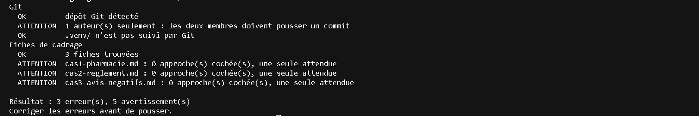
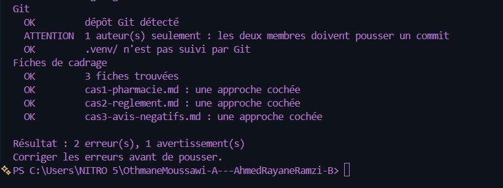

# sentiment-app : dépôt du binôme

Application fil rouge du cours *Développement et déploiement d'applications intelligentes*.
Un classifieur de sentiment qui fait remonter les avis clients négatifs en tête de file, construit en trois séances sur le même dépôt. Rien n'est jeté.

| Séance | Ce que contient le dépôt | Documents |
| --- | --- | --- |
| TP1 | Structure, environnement, trois fiches de cadrage | [docs/cadrage/](docs/cadrage/) |
| TP2 | Modèle TF-IDF + régression logistique, évaluation, métriques versionnées | [docs/semaine2.md](docs/semaine2.md) |
| TP3 | Interface de démonstration Streamlit | [docs/semaine3.md](docs/semaine3.md) |
| Rendu | Compte rendu global | [docs/compte-rendu.md](docs/compte-rendu.md) |

## Démarrage rapide

```bash
python -m venv .venv
source .venv/bin/activate        # Windows PowerShell : .venv\Scripts\Activate.ps1
pip install -r requirements.txt
python scripts/check_setup.py
pytest -q
```

## Reconstruire le modèle et lancer l'interface

Le modèle n'est jamais versionné : il se reconstruit sur chaque poste. Seule sa mesure, `models/metrics.json`, est dans Git.

```bash
python src/make_demo.py          # data/demo_reviews.csv : 290 avis de démonstration
python src/train.py --allocine   # models/sentiment.joblib, F1 macro 0,920
python src/evaluate.py           # matrice de confusion
python src/predict.py "Livraison rapide, très satisfait"
streamlit run ui/app.py          # http://localhost:8501
```

Une fois le modèle entraîné, `pytest -q` affiche 45 passed. En CI, où le modèle est absent, les quatre tests qui en ont besoin sont ignorés.

## Captures des tests (TP1)

### Avant correction

État initial du diagnostic : les dépendances Python ne sont pas encore installées et les trois fiches de cadrage ne contiennent pas encore d'approche cochée.



### Après correction des fiches

Les trois approches sont cochées dans les fiches de cadrage. À ce stade, il restait 2 erreurs et 1 avertissement liés à la configuration Python et aux commits du binôme ; ils ont été résolus depuis.



## Membres du binôme

| Rôle | Nom | Identifiant GitHub | Travail de la semaine 1 |
| --- | --- | --- | --- |
| Membre A | Othmane Moussawi | @OthmaneW37 | Cadrage des trois cas et préparation de l'environnement |
| Membre B | Ahmed Rayane Ramzi | @RayaneRZ24  | Cadrage des trois cas et préparation de l'environnement |
