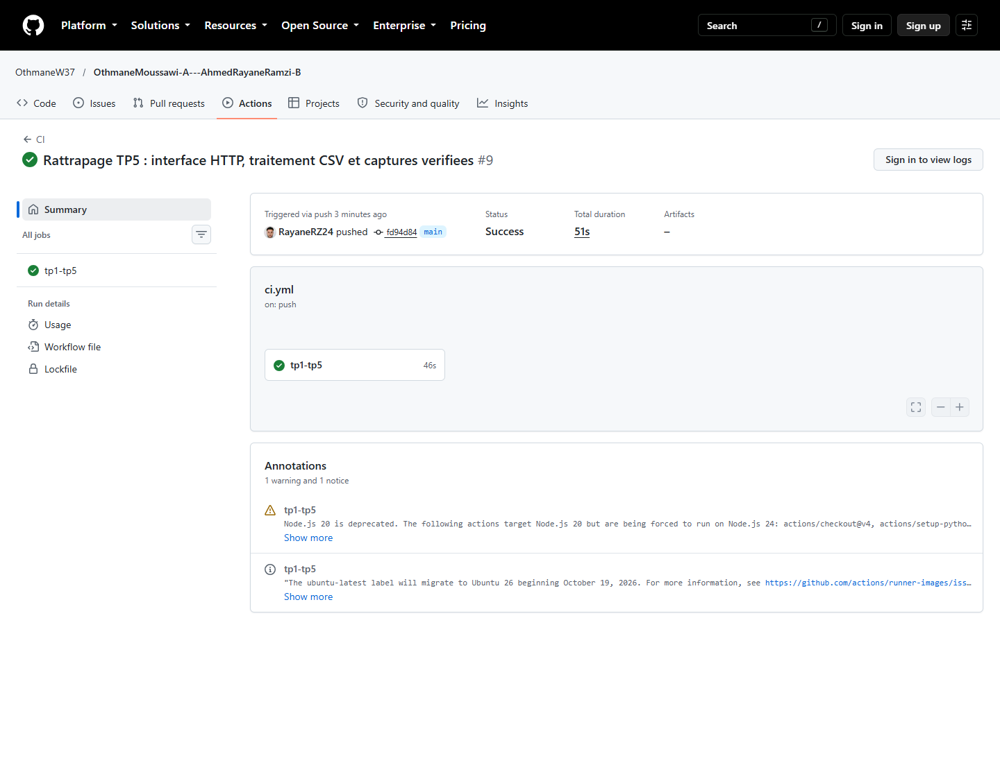

# Journal de rattrapage : TP1 à TP5

Vérifications effectuées le **21 octobre 2026** dans le dépôt du binôme, suivant le guide de rattrapage d'octobre 2026 et les archives étudiantes fournies.

| | Membre A | Membre B |
| --- | --- | --- |
| Nom | Othmane Moussawi | Ahmed Rayane Ramzi |
| GitHub | @OthmaneW37 | @RayaneRZ24 |

Dépôt : https://github.com/OthmaneW37/OthmaneMoussawi-A---AhmedRayaneRamzi-B

Le dépôt contenait déjà les TP1–TP2 et une ancienne version du TP3 où Streamlit chargeait directement le modèle. Les scripts TP2 ont été comparés au nouveau kit : leur contenu était identique, indépendamment des fins de ligne. La nouvelle chaîne place l'API en TP3 et l'interface HTTP en TP5. Les anciens travaux et comptes rendus sont conservés dans l'historique et dans `docs/archives/`.

Les états initiaux volontairement incomplets du guide n'ont pas été recréés en effaçant les travaux existants. Les mesures de départ de l'API ont été prises sur une copie temporaire de son code original du kit, avec les tests complétés et le même modèle. Les résultats ci-dessous sont ceux de cette exécution, pas des nombres attendus recopiés du guide.

## Préparation et TP1

| Contrôle | Résultat obtenu | Preuve / commentaire |
| --- | --- | --- |
| Python / Git | Python 3.11.9, environnement `.venv`, deux auteurs dans l'historique | Identité Git du poste : Ramzi Ahmed Rayane ; aucune identité changée |
| T0 : structure | Tous les répertoires et fichiers requis présents | [Diagnostic](verification/diagnostic.txt) |
| T1 : installation | `requirements.txt` et `requirements-dev.txt` installés ; `pip check` : `No broken requirements found.` | Contrainte directe pyarrow 21 retirée ; pyarrow 17.0.0 retenu avec MLflow et Streamlit ; verrou actualisé |
| T2 : cadrage | 12 tests validés | Pharmacie : règles ; règlement : RAG ; avis : ML ; justifications déjà présentes conservées |
| T3 : fichiers suivis | Ni `.env`, ni `.venv/`, ni joblib, ni données générées | Vérification `git ls-files` sur ces chemins : aucune sortie |
| T4 : diagnostic du poste disponible | 0 erreur, 0 avertissement | [Sortie complète](verification/diagnostic.txt) ; ne vaut pas preuve d'une exécution sur les deux postes |
| T5 : auteurs | OthmaneW et Ramzi Ahmed Rayane ; 3 tests Git validés | Les commits de rattrapage utilisent uniquement l'identité déjà configurée |
| T6 : suite finale | Les 38 contrôles TP1 passent dans la suite complète | 102 passed, 4 xfailed au total après TP5 |
| T7 : installation sur clone neuf | CI réussie, puis clone GitHub et venv neufs sur ce PC | [Nouvelle vérification indépendante](verification/clone-independant.txt) ; un deuxième poste physique reste distinct |

Le modèle et l'environnement ne figurent pas non plus dans l'historique : `git log --all --oneline -- models/sentiment.joblib .venv` ne renvoie aucune ligne.

## TP2 : modèle reproductible

| Contrôle | Résultat obtenu | Interprétation |
| --- | --- | --- |
| C1 : kit | Les quatre scripts existants correspondaient au kit TP2 | Typage et corrections de qualité ajoutés ensuite au TP4 |
| C2 : génération | 290 avis : 145 positifs, 145 négatifs, dont 100 mitigés et 30 neutres | Données générées ignorées par Git |
| C3 : entraînement | 232 avis d'entraînement, 58 de test ; vocabulaire 316 ; F1 macro 0,879 | [Sortie enregistrée](verification/entrainement-demo.txt) |
| C4 : évaluation | Matrice `[[27, 2], [5, 24]]` ; 7 erreurs sur 58 | Les avis mitigés mettent en défaut le sac de mots ; [analyse](semaine2.md) |
| C5 : Allociné | 20 000 avis ; F1 macro 0,9205 ; rappel négatif 0,9113 | [Métriques de la nouvelle exécution](verification/metrics-allocine.json) |
| Modèle final | Retour au modèle de démonstration pour TP3–TP5 | `models/metrics.json` correspond au modèle actif ; le joblib reste local |

## TP3 : API FastAPI

| Contrôle | Résultat obtenu | Preuve |
| --- | --- | --- |
| T14 | 6 tests API réussis ; aucune dépendance à un serveur lancé pour pytest | `tests/test_api.py` |
| T15 | `/health` : 200, status `OK`, modèle TP2 | [Capture réelle](captures/tp3-t15-health.png) |
| T16 | Avis positif : `POSITIVE`, 0,777 | [Réponse HTTP réelle](verification/essais-http.json) |
| T17 | Avis négatif : `NEGATIVE`, 0,7465 | Même relevé HTTP |
| T18 | Texte vide, champ absent, nombre : 422 | Tests API ; espaces également vérifiés dans le navigateur |
| T19 | Entraînement ajouté avant les tests dans la CI | `.github/workflows/ci.yml` |
| T20 | Fichier absent et cache vidé : `FileNotFoundError` au démarrage | `test_modele_absent_refuse_demarrage` ; [réponses aux deux questions](semaine3.md) |

## TP4 : défauts, abstention et qualité

| Contrôle | Résultat obtenu | Preuve |
| --- | --- | --- |
| T21 : couverture initiale | 91 %, 6 instructions non couvertes | [Sortie initiale](verification/couverture-avant.txt) |
| T21 : qualité initiale | 17 remarques ruff, 0 erreur mypy | [Ruff](verification/ruff-avant.txt), [mypy](verification/mypy-avant.txt) |
| Défauts avant correction | 5 failed, 13 passed sur les tests limites/intégration complétés | [Échecs réels](verification/defauts-avant.txt) |
| T22 | Espaces et blancs Unicode refusés avec `detail` en liste | `field_validator` utilisant `str.strip()` |
| T23 | 11 tests limites réussis ; propriétés vérifiées sur au moins trois exécutions | Un cas Unicode explicite de plus que les huit frontières minimales |
| T24 | Mots inconnus : `INDETERMINE`, 0,5162 | Seuil mesuré et nommé à 0,60 ; [courbe](verification/courbe-seuil.txt) |
| T25 | 20 avis, dont 10 difficiles ; 5 justes, 11 abstentions, 4 erreurs déclarées | [Bilan](verification/bilan-jeu-or.txt) ; 17 passed, 4 xfailed stricts |
| T26 | Démarrage, absence, 503, pannes RuntimeError/ValueError, classes inconnues vérifiés | 7 tests d'intégration ; couverture API **97,70 %**, sans exclusion |
| T27 : outils | Ruff et mypy sans erreur | [Sorties](verification/qualite.txt) |
| T27 : hook | Import `os` inutile : commit refusé avec F401, code 1, HEAD inchangé | [Essai réel](verification/precommit-refus.txt) ; fichier d'essai retiré |
| Suite complète | **102 passed, 4 xfailed**, aucun test ignoré, aucun failed | [Sortie et couverture](verification/tests-et-couverture.txt) |

Les quatre erreurs connues restent visibles dans le jeu d'or ; elles ne sont pas des réussites du modèle. Les textes et les étiquettes attendues n'ont pas été modifiés après observation des résultats. Les explications et les limites sont détaillées dans [semaine4.md](semaine4.md). Les 20 avis ont été proposés avec assistance, puis leur sens et leurs étiquettes ont fait l'objet d'une [relecture assistée documentée](relecture-jeu-or.md) à la demande du binôme. Cela ne constitue pas une rédaction personnelle de dix avis par chacun.

## TP5 : page Streamlit et essais réels

Les 7 tests du client et les 5 tests de page passent. Les captures suivantes viennent d'un navigateur sur une vraie API et une vraie page, temporairement lancées sur les ports 18000 et 18501. Les services ont été arrêtés à la fin de l'essai.

| Contrôle | Résultat obtenu | Capture |
| --- | --- | --- |
| T28 | 12 tests du kit TP5 réussis | `test_client.py` et `test_interface.py` |
| T29 | Page : « API prête » et nom du modèle TP2 | [Capture](captures/tp5-t29-api-prete.png) |
| T30 positif | « Avis positif », 78 % | [Capture](captures/tp5-positif.png) |
| T30 négatif | « Avis négatif », 75 % | [Capture](captures/tp5-negatif.png) |
| T31 | « Je ne sais pas : à faire vérifier par un humain », 52 % | [Capture](captures/tp5-abstention.png) |
| T32 espaces | Avertissement « Texte refusé » | [Capture](captures/tp5-t32-refus.png) |
| T32 arrêt de l'API | Rechargement : « API injoignable » | [Capture](captures/tp5-t32-api-arretee.png) |
| T32 modèle retiré | 503 traduit en message « Modèle non chargé » | `test_modele_non_charge` |
| T33 | CSV : 3 positifs, 2 négatifs, 1 abstention ; téléchargement de six lignes | [Capture](captures/tp5-t33-lot.png), [CSV réellement téléchargé](verification/resultats-exemple.csv) |
| T34 | Code poussé et contrôlé par GitHub Actions | Voir CI ci-dessous |

Les réponses aux trois questions du TP5 figurent dans [semaine5.md](semaine5.md).

## CI et historique

Les cinq commits initiaux de rattrapage ont été redécoupés par fonctionnalité à la demande du binôme : environnement, mesures du modèle, archives, API, tests aux limites, abstention, jeu d'or, intégration, CI, client HTTP, page Streamlit et documentation. Ce découpage réorganise le même travail ; il ne représente pas autant de séances supplémentaires. Les auteurs et dates n'ont pas été inventés. L'ancien historique est conservé dans la branche `sauvegarde/rattrapage-2026-10-21-ea4e075`.

Le workflow [CI du code de rattrapage](https://github.com/OthmaneW37/OthmaneMoussawi-A---AhmedRayaneRamzi-B/actions/runs/39638780315) installe les dépendances nécessaires aux TP1–TP5 dans un venv neuf sous Ubuntu/Python 3.11, lance le diagnostic, génère les avis, entraîne le modèle puis contrôle ruff, mypy et pytest avec couverture minimale de 95 %. Il n'installe pas les dépendances des semaines futures ; l'installation de tout le semestre a été vérifiée sur le poste Windows.

**Résultat confirmé : succès.** Les étapes de diagnostic, entraînement, ruff, mypy et tests/couverture ont toutes réussi sur GitHub Actions pour le commit `fd94d84`.

## Vérifications qui nécessitent le binôme ou le propriétaire

- [x] Clone GitHub et venv neufs : installation des dépendances TP1–TP5, diagnostic, entraînement, bilan du jeu d'or, ruff, mypy, 102 passed / 4 xfailed et installation du hook refaits sur le même PC. Ce contrôle n'est pas attribué au poste du membre A.
- [x] Relecture technique assistée des vingt avis et vérification de leurs étiquettes, sans masquer les quatre erreurs connues.
- [ ] Si l'enseignant exige dix avis rédigés personnellement par chaque membre, fournir cette contribution personnelle ; la relecture assistée ne remplace pas cette exigence.
- [ ] Chaque membre rejoue la vérification sur son propre poste, installe le hook et commite ses observations sous son identité. Les nouveaux commits ne prouvent pas une exécution sur deux postes.
- [ ] Othmane règle la visibilité : le dépôt est **public** au moment du contrôle, alors que le guide demande un dépôt privé. Le compte connecté dispose du droit de pousser, pas d'administrer le dépôt.
- [ ] Le propriétaire vérifie les invitations et l'accès du professeur `Larhlimiabd-ai` après passage en privé. Aucun accès ni aucune invitation n'ont été modifiés automatiquement.

Pour refaire les contrôles et les afficher au professeur : `.\scripts\verifier.ps1 -Detail` après activation de `.venv`. Les captures initiales de TP1 déjà présentes dans le dépôt restent historiques ; aucune fausse capture de poste ou de collaboration n'a été créée.
