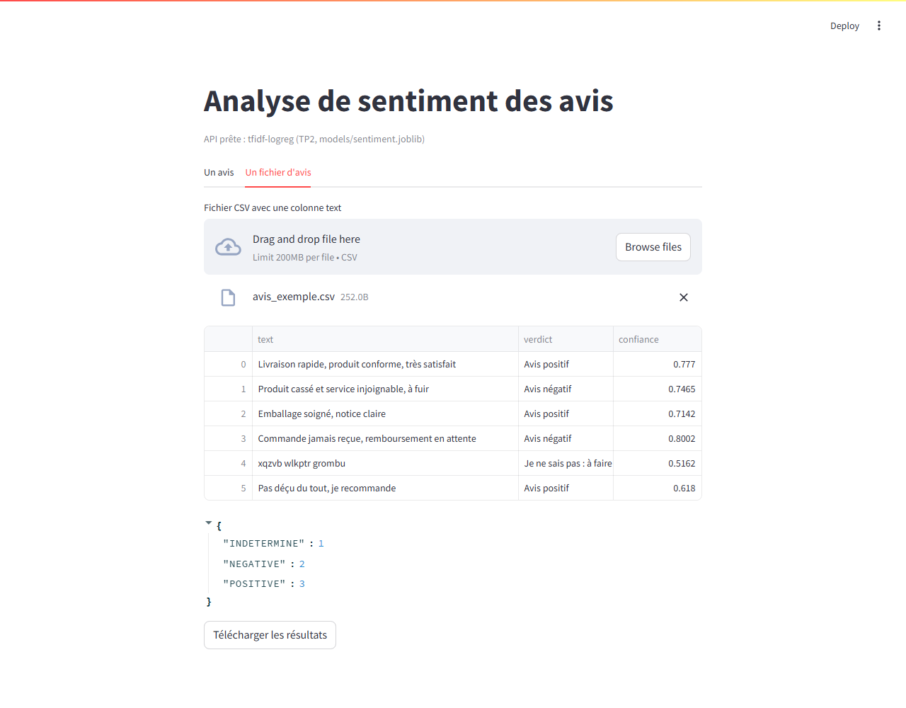
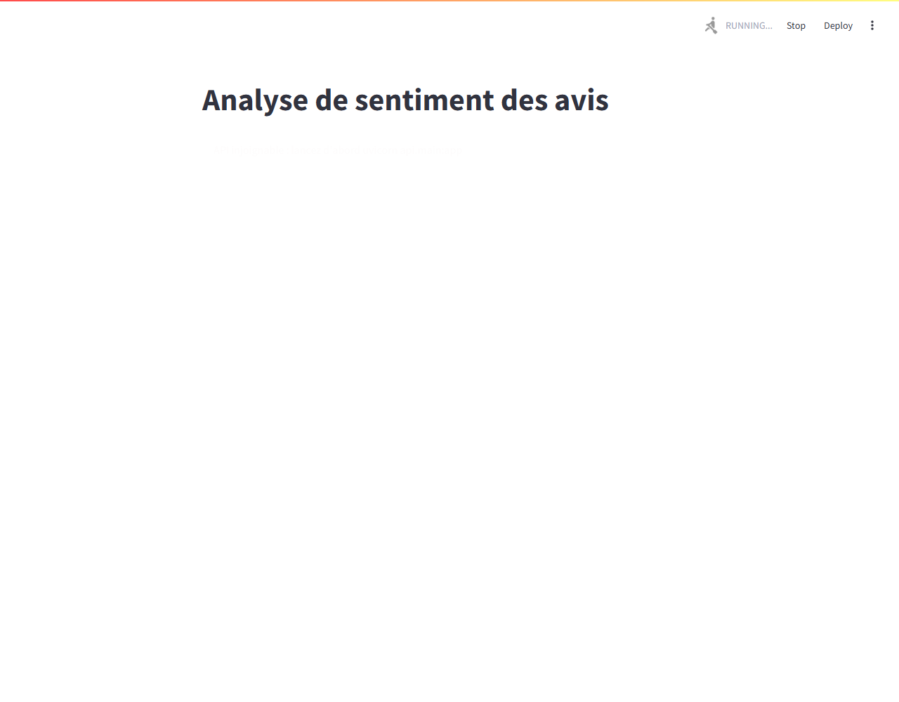

# Semaine 5 : interface cliente de l'API

Vérifications du 21 octobre 2026 : les 7 tests du client et les 5 tests de page du kit passent. Des essais supplémentaires ont été faits dans un navigateur avec une vraie API uvicorn et une vraie instance Streamlit, sur des ports temporaires 18000 et 18501 pour isoler la vérification. Les services temporaires ont été arrêtés à la fin.

## 1. Pourquoi la page n'importe-t-elle pas le modèle ?

La page `ui/app.py` appelle seulement `ui/client.py`, qui envoie `/health` et `POST /predict` par HTTP. Le chargement du joblib et le seuil restent côté API : un nouveau modèle ne demande donc pas de modifier la page. Les tests remplacent la session HTTP par `TestClient` ; `AppTest` exécute le script Streamlit et vérifie ses éléments. L'ancien `ui/helpers.py` est conservé uniquement pour les trois tests historiques de l'ancienne interface ; il n'est pas importé par la page actuelle.

## 2. Que montre la page quand le modèle hésite ?

« xqzvb wlkptr grombu » donne `INDETERMINE`, confiance 0,5162 affichée **52 %**, avec le verdict « Je ne sais pas : à faire vérifier par un humain » et un message sur le seuil d'abstention. Cela évite d'envoyer automatiquement un avis inconnu dans une mauvaise file. Les avis évidents du guide donnent **Avis positif, 78 %** et **Avis négatif, 75 %**.

## 3. Erreurs et traitement d'un fichier

Trois espaces provoquent le message « Texte refusé : vide, fait d'espaces, ou de plus de 2000 caractères. ». Après arrêt réel de l'API et rechargement, la page affiche « API injoignable : lancez d'abord uvicorn api.main:app ». Le client traduit aussi le 503 en « Modèle non chargé : python src/train.py, puis relancer l'API. », vérifié par `test_modele_non_charge`.

Le fichier `data/avis_exemple.csv` produit **3 POSITIVE, 2 NEGATIVE, 1 INDETERMINE** : un avis sur six part vers un humain. Le tableau donne les verdicts et les confiances ; le bouton télécharge effectivement les six lignes en CSV. Le [fichier téléchargé lors de l'essai](verification/resultats-exemple.csv) est conservé avec les [réponses HTTP](verification/essais-http.json).

